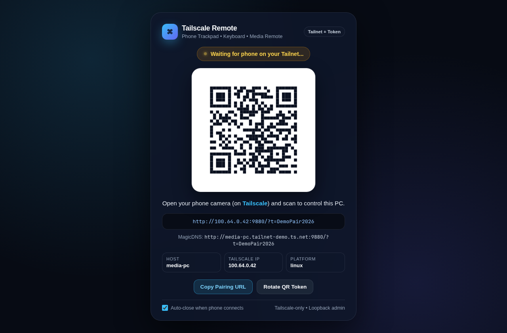
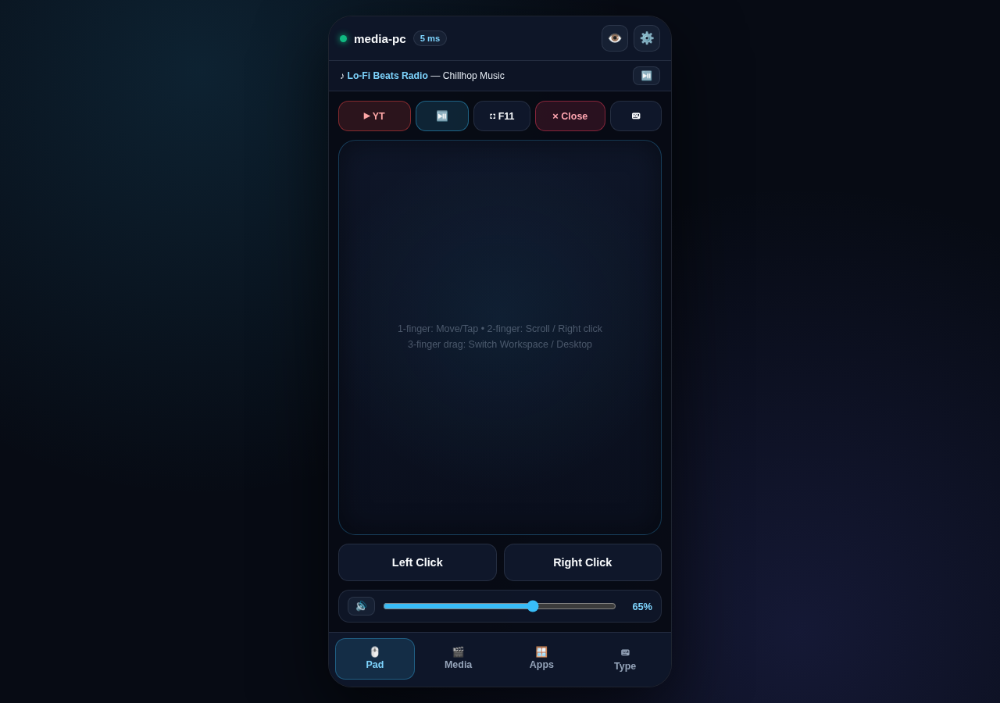
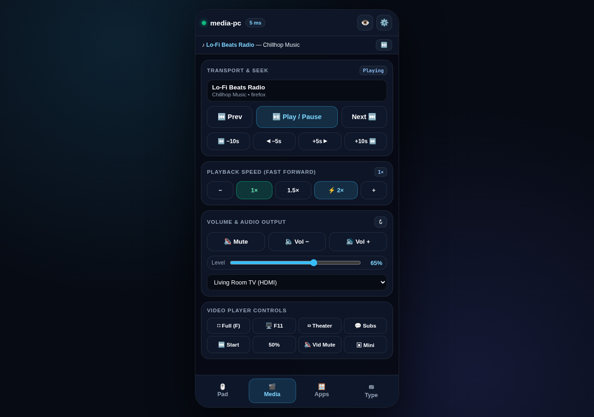
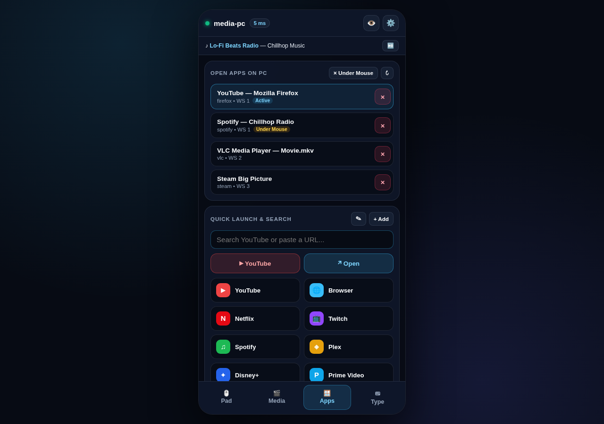
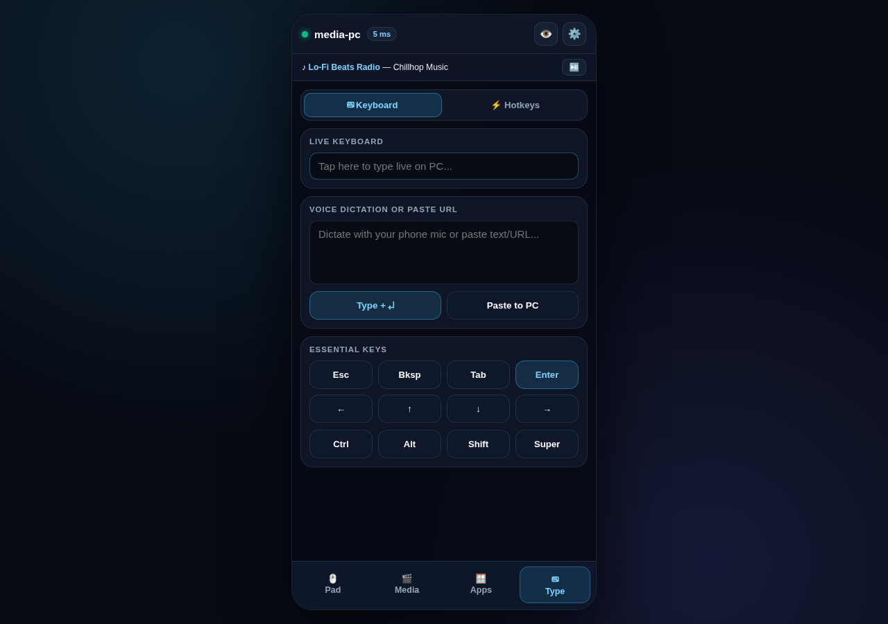
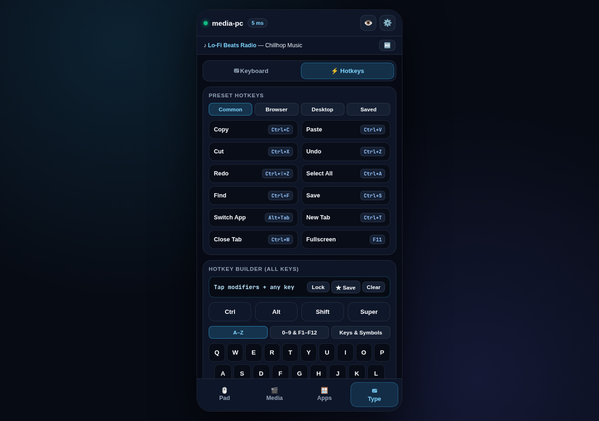

# 📱 Tailscale Remote — Phone Trackpad, Keyboard & Media KVM (Pure Rust)

A low-latency, cross-platform wireless phone-to-PC input bridge built in **100% pure Rust** (**Axum**, **Tokio**, and **evdev/Win32/CoreGraphics**) that displays an instant pairing **QR code** over your **Tailscale** mesh VPN so your phone becomes a simple, couch-friendly trackpad, open-app switcher, YouTube launcher, and live keyboard whenever your mouse and keyboard are out of reach.

<div align="center">


</div>

---

## ✨ Showcase Preview

<div align="center">



*Instant Launch QR Pairing Screen (`http://127.0.0.1:9880/qr`) featuring live Tailscale IP/MagicDNS discovery, token rotation, and automatic countdown dismissal upon phone connection.*

<br />



*Pad Tab: Uncluttered multi-touch trackpad with `▶ YT`, `⏯`, `⛶ F11`, one-tap `✕ Close` (closes window under mouse), keyboard shortcut, live volume slider, and Screen Peek (`👁`).*

<br />



*Media Tab: Dedicated couch media remote featuring hero transport (`Prev`, `Play/Pause`, `Next`), `±5s`/`±10s` seeking, `1×`/`1.5×`/`2×` playback speed toggles, Mute & Volume controls, HDMI/Speaker output switcher, and Video Player controls.*

<br />



*Apps Tab: Live Open Apps switcher (`Active` & `Under Mouse` badges, tap to focus or `✕` to close), direct YouTube search & URL opener, customizable Quick-Launch deck, and TV D-Pad.*

<br />



*Type Tab: Real-time mobile keyboard streaming, voice dictation / clipboard paste to PC, essential navigation keys, and sticky modifier toggles.*

<br />



*Hotkeys Studio: 1-tap Common, Browser, Desktop & Saved hotkey presets plus a visual Hotkey Builder with `Ctrl`/`Alt`/`Shift`/`Super` toggles and full `A–Z`, `0–9`, `F1–F12`, navigation, and symbol key banks.*

</div>

---

## 🌟 Key Features

- **Instant Dual-Mode QR Pairing on Launch:** Generates an **SVG QR pairing screen** (`http://127.0.0.1:9880/qr` auto-opened in a frameless app window) alongside a high-contrast **Unicode half-block terminal QR code**, dynamically binding to your host's **Tailscale IPv4 (`100.x.y.z`)** or **MagicDNS** name via `tailscale status --json`.
- **Zero-Trust Tailscale-Only Enforcement & Cryptographic Tokens:** Binds strictly to **`127.0.0.1`** and the host's **Tailscale interface**, enforces **Tailscale CGNAT (`100.64.0.0/10`)** and **ULA (`fd7a:115c:a1e0::/48`)** client IP verification, validates **`Host` and `Origin` headers** to defeat DNS rebinding and Cross-Site WebSocket Hijacking (CSWSH), protects **`/qr`**, **`/ws/host`**, and **`/api/token/rotate`** with loopback + CSRF header guards (`403` otherwise), immediately **revokes active `/ws/remote` sessions on token rotation**, applies **per-IP failed-auth rate limiting**, enforces strict **`Content-Security-Policy` / `X-Frame-Options: DENY` / `Referrer-Policy: no-referrer` / `Cache-Control: no-store`** headers, and authenticates phones using a **12-character Base62 CSPRNG token (`getrandom`, or `TSR_TOKEN` env var)** persisted in an **`HttpOnly; SameSite=Lax`** cookie.
- **Open Apps Switcher & Close-Under-Mouse Control:** Queries live desktop windows across **Hyprland 0.56+ Lua IPC (`hl.dsp.focus` / `hl.dsp.window.close` / `hl.dsp.dpms`)**, **X11 (`wmctrl`)**, **Windows (Win32 HWND)**, and **macOS (`osascript`)** so you can switch to any open app, close individual windows, or tap **`✕ Close`** right above the trackpad to close whichever window the cursor is hovering over.
- **1-Tap Hotkey Presets & Visual Key Builder:** Dedicated **`⚡ Hotkeys`** studio offering **Common / Browser / Desktop / Saved** hotkey preset grids (`Ctrl+C/V/Z`, `Alt+Tab`, `Ctrl+Shift+T`, `Super+Space`, etc.) alongside a full visual **QWERTY (`A–Z`), `0–9 & F1–F12`, and Keys/Symbols** builder with modifier lock and custom preset saving.
- **Quick-Launch Deck, YouTube Search & Couch Controls:** One-tap **YouTube**, **Browser**, **Netflix**, **Twitch**, **Spotify**, **Plex**, **Disney+**, **Prime Video**, and **Steam Big Picture** tiles with persistent custom shortcuts (`shortcuts.json`), direct **YouTube Search / URL Opener**, and a TV **D-Pad + Zoom (`Ctrl ±`)** pad.
- **Synced Audio, Now Playing, Screen Peek, Sleep Timer & Power:** Reads and controls real system volume (`0–100%`) and **Audio Outputs** (**PipeWire/PulseAudio `pactl`/`wpctl`**, **AppleScript/SwitchAudioSource**), surfaces **Now Playing** metadata (**MPRIS `playerctl`/`busctl`**), captures live **Screen Peek** JPEGs (`grim`/`ffmpeg`), schedules **Sleep Timers**, and exposes confirmed **Power** & **Tailnet Multi-PC Switcher** actions inside the `⚙` drawer.
- **Cross-Platform Kernel & OS Virtual HID Injection:** Drives native pointer, scroll, keyboard, and media events across **Linux Wayland/Hyprland & X11 (`/dev/uinput` via `evdev`)**, **Windows (`SendInput` with UTF-16 `KEYEVENTF_UNICODE`)**, and **macOS (`CoreGraphics` `CGEvent` FFI)** on a dedicated bounded worker thread with automatic **`ReleaseAll` safety cleanup** on disconnect.

---

## 🏗 Architecture & Tech Stack

```text
+-----------------------------------+        Encrypted Tailscale WireGuard Tunnel
|     PHONE BROWSER (iOS/Android)   |        http://100.x.y.z:9880/?t=<12-char>
|  • Pad   : Trackpad + F11 + Close | <==========================================+
|  • Media : 2× Speed + Seek + Vol  |        WebSocket (/ws/remote) + REST API   |
|  • Apps  : Open Windows + Launch  |                                            |
|  • Type  : Keyboard + Hotkeys     |                                            |
+-----------------------------------+                                            v
                                                          +-----------------------------------+
+-----------------------------------+  Loopback WS        |    TAILSCALE REMOTE HOST (Rust)   |
|     TV / MONITOR QR WINDOW        |  (/ws/host)         |  • Axum 0.8 + Tokio Async Server  |
|  • http://127.0.0.1:9880/qr       | <-----------------> |  • Tailnet IP & Token Middleware  |
|  • Auto-closes 3s after pairing   |                     |  • Bounded HID Channel (512)      |
+-----------------------------------+                     +-----------------------------------+
                                                                     |              |
                                           +-------------------------+              +-------------------------+
                                           v                                                                  v
                       +---------------------------------------+                          +-----------------------------------+
                       |      NATIVE VIRTUAL HID WORKER        |                          |     SYSTEM & WINDOW INTEGRATIONS  |
                       |  Linux  : /dev/uinput (evdev)         |                          |  • Hyprland 0.56 Lua / Win32 / Mac|
                       |  Windows: Win32 SendInput + clip.exe  |                          |  • pactl Audio & busctl MPRIS     |
                       |  macOS  : CoreGraphics CGEvent        |                          |  • grim / ffmpeg Screen Peek      |
                       +---------------------------------------+                          +-----------------------------------+
```

### Repository Layout
```text
tailscale-remote/
├── src/
│   ├── main.rs        # CLI flags, Tailscale detection, dual-bind server & QR browser launcher
│   ├── server.rs      # Axum HTTP/WebSocket router, Tailscale/loopback guards & REST APIs
│   ├── system.rs      # Window switcher/close-under-cursor, shortcuts, audio, MPRIS, Screen Peek & Power
│   ├── input.rs       # Dedicated virtual HID worker (Linux uinput, Win32 SendInput, macOS CGEvent)
│   ├── keymap.rs      # Web KeyboardEvent.code, ASCII QWERTY, Media, Win32 VK & macOS keycode tables
│   ├── protocol.rs    # Typed JSON WebSocket wire messages (ClientMsg, ServerMsg, HostEvent)
│   ├── qr.rs          # CSPRNG Base62 token generator, SVG QR & Unicode half-block terminal QR
│   └── tailscale.rs   # `tailscale status --json` parser, peer label lookup & CGNAT/ULA IP guards
├── static/
│   ├── qr.html        # Zero-dependency dark-mode TV/Desktop QR pairing screen
│   └── remote.html    # Self-contained 4-tab mobile Pad / Media / Apps / Type PWA UI + ⚙ drawer
├── demoPics/          # Showcase screenshots for portfolio synchronization
├── build.sh / build.ps1
└── run-remote.sh / run-remote.ps1
```

---

## 🚀 Setup & Installation

### 1. Prerequisites
- **Tailscale** installed and logged in on both your media PC and your phone (`tailscale up`).
- **Rust toolchain** (`rustc` + `cargo`, 2021 edition).
- *(Linux optional utilities)* `wl-clipboard` / `xclip` (clipboard paste), `grim` (Wayland Screen Peek), `pulseaudio-utils` / `wireplumber` (audio switcher).

### 2. Build the Binary
```bash
git clone https://github.com/ryguy0601/tailscale-remote.git
cd tailscale-remote

# Linux / macOS
./build.sh
```
```powershell
# Windows (PowerShell)
.\build.ps1
```

### 3. Linux `/dev/uinput` Permissions (One-Time Setup for Wayland / X11)
To allow `tailscale-remote` to emit virtual mouse and keyboard events without `sudo`:
```bash
echo uinput | sudo tee /etc/modules-load.d/uinput.conf
echo 'KERNEL=="uinput", MODE="0660", GROUP="input", OPTIONS+="static_node=uinput"' | sudo tee /etc/udev/rules.d/99-uinput.rules
sudo usermod -aG input "$USER"
sudo modprobe uinput && sudo udevadm control --reload-rules && sudo udevadm trigger
# Log out and back in (or run `newgrp input`) so group membership applies
```

### 4. Launch & Scan
```bash
# Linux / macOS — opens the QR pairing screen & prints a terminal QR
./run-remote.sh

# Auto-start on login (headless terminal/background mode)
./run-remote.sh --install-startup
```
```powershell
# Windows (PowerShell)
.\run-remote.ps1

# Auto-start on Windows logon
.\run-remote.ps1 -InstallStartup
```

---

## 🎮 Touch Gestures & CLI Options

### Trackpad Gestures
| Gesture | PC Action |
| --- | --- |
| **1-Finger Drag** | Smooth accelerated pointer movement |
| **1-Finger Tap** | Left click |
| **Double-Tap & Hold** | Left-button click-and-drag |
| **2-Finger Drag** | Vertical & horizontal smooth scrolling |
| **2-Finger Tap** | Right click |
| **3-Finger Horizontal Drag** | Switch to next / previous workspace / desktop |
| **3-Finger Tap** | Middle click |

### CLI Flags
| Flag | Description |
| --- | --- |
| `-p, --port <PORT>` | TCP port to listen on (default: `9880`) |
| `--token <TOKEN>` | Use a custom pairing token instead of an ephemeral 12-char token (or set `TSR_TOKEN` env var) |
| `--no-auth` | Disable pairing token requirement (remains Tailscale-only) |
| `--use-magicdns` | Embed MagicDNS hostname instead of Tailscale IPv4 in the QR URL |
| `--no-browser` / `--cli` | Print terminal QR only without opening the desktop browser popup |
| `--dry-run` | Log input, launch, window, and power events without emitting OS changes |
| `--allow-lan` | Allow non-Tailscale LAN IPs (for local testing without a tailnet) |
| `--bind <IP[:PORT]>` | Override or specify a custom bind address |

---

## 📄 License

Distributed under the [MIT License](LICENSE).
